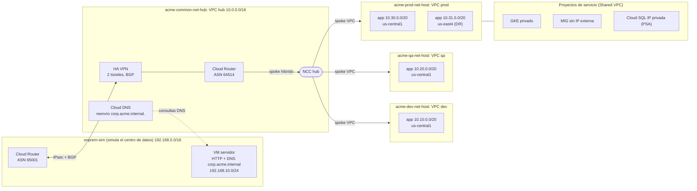

# Arquitectura de red: hub-and-spoke con NCC y HA VPN

- Cada VPC de entorno tiene Cloud NAT por región para salida a Internet; ninguna VM tiene IP externa.
- Las zonas privadas `<env>.gcp.acme.internal.` viven en cada VPC de entorno; `corp.acme.internal.` se reenvía a on-prem.
- La administración por SSH entra por IAP (`35.235.240.0/20`), sin bastión público.
