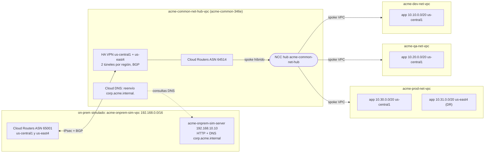
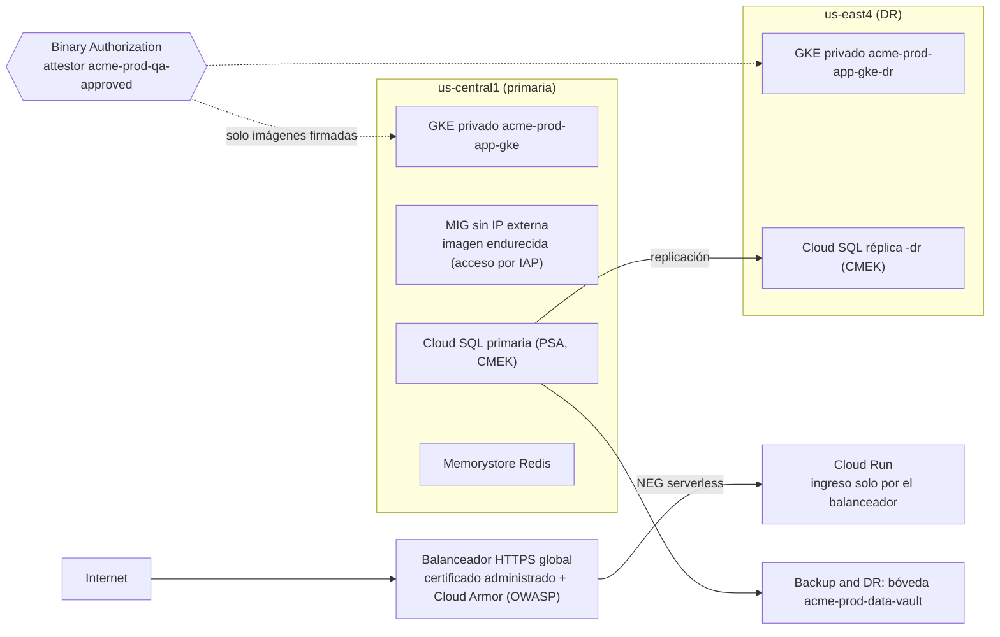

# Arquitectura: red hub-and-spoke, conectividad híbrida y cargas

## Cargas de prod (primaria us-central1, DR us-east4)

- Cada VPC de entorno tiene Cloud NAT por región para salida a Internet; ninguna VM tiene IP externa.
- Las zonas privadas `<env>.gcp.acme.internal.` viven en cada VPC de entorno; `corp.acme.internal.` se reenvía a on-prem.
- La administración por SSH entra por IAP (`35.235.240.0/20`), sin bastión público.
- Los planos de control de GKE son privados (`172.16.<n>.0/28`); el endpoint DNS se habilita solo durante un DR
  (runbook `dr-failover-cloudsql.md`, sección 4b).
- RPO ≤ 15 min y RTO ≤ 4 h (ADR 0014-j); el simulacro midió RPO 0 s y RTO 39 min (`registro/simulacro-dr-2026-11-25.md`).
- dev y qa tienen las mismas cargas en una sola región, sin réplica ni clúster DR.
