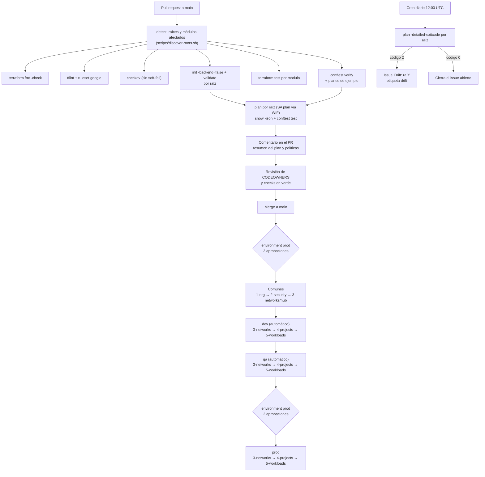

# Flujo de CI/CD

- Solo se aplican las raíces que cambió el push; un cambio en `modules/` aplica todas.
- Cada raíz aplica con la SA de su etapa y entorno; los jobs de una misma raíz no corren en paralelo.
- `0-bootstrap` no está en el pipeline: lo aplica un administrador (runbook `bootstrap-first-apply.md`).
