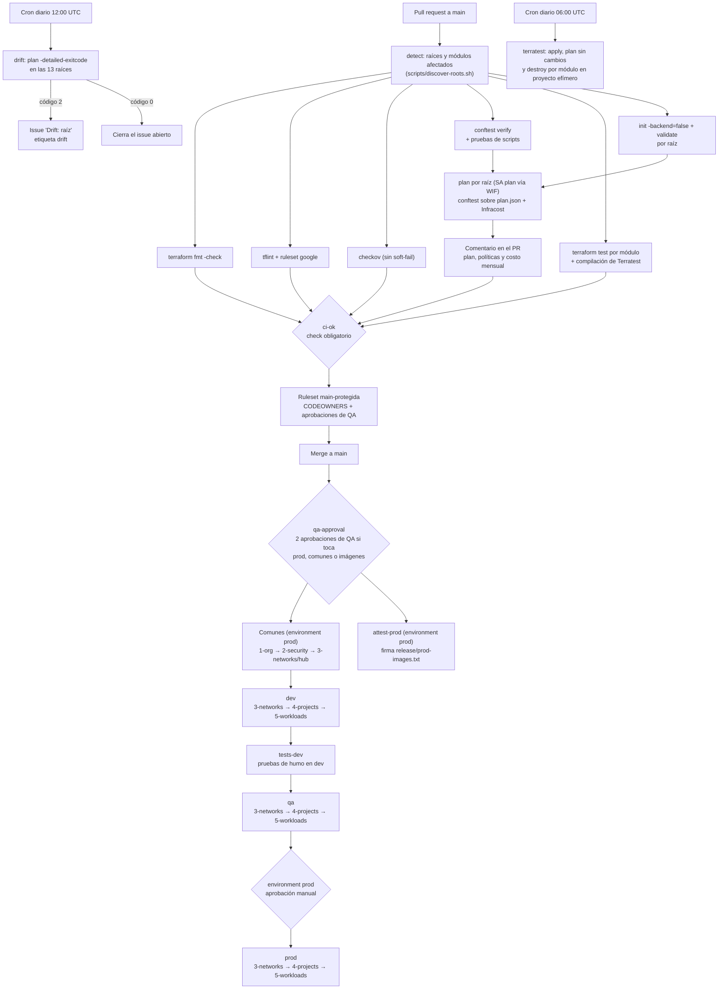

# Flujo de CI/CD

- Solo se aplican las raíces que cambió el push; un cambio en `modules/` aplica todas.
- Cada raíz aplica con la SA de su etapa y entorno; los jobs de una misma raíz no corren en paralelo.
- La puerta de QA está relajada temporalmente con `QA_MIN_APPROVALS` (ADR 0021-k); se restaura antes de la entrega.
- Infracost necesita el secreto `INFRACOST_API_KEY`; sin él el paso se omite y el PR no se bloquea.
- `0-bootstrap` no está en el pipeline: lo aplica un administrador (runbook `bootstrap-first-apply.md`).
