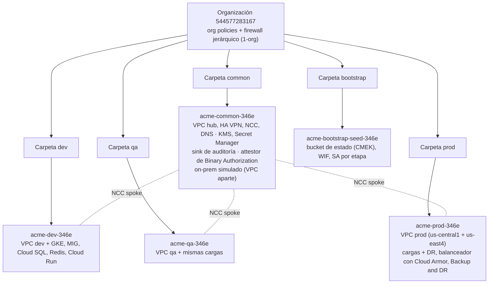

# Jerarquía de recursos

Lo desplegado en la organización de prueba usa `compact_projects = true` (`stages/1-org/lab.tfvars`): un proyecto
`common` y un proyecto por entorno que aloja red, app y datos. Así cabe en la cuota de proyectos y créditos.

- Cada entorno tiene su perímetro de VPC Service Controls (`2-security`, en dry-run: ADR 0006-e).
- Con `compact_projects = false` el diseño completo separa cada carpeta en proyectos por función: `common` en
  `net-hub`, `logging`, `security` y `backup`; cada entorno en `net-host` (Shared VPC), `app` y `data`. El código es
  el mismo; solo cambia la variable.
- `346e` es `var.suffix` (4 caracteres hex) para que los IDs globales sean únicos.
- Etapa responsable: carpetas y proyectos en `1-org`; red en `3-networks`; proyectos de entorno en `4-projects`;
  cargas en `5-workloads`.
