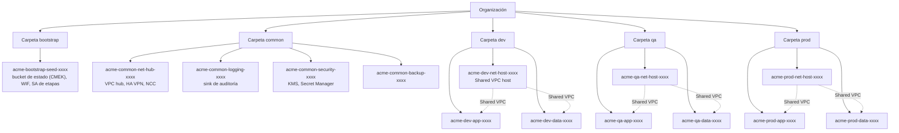

# Jerarquía de recursos

- `xxxx` es `var.suffix` (4 caracteres hex) para que los IDs globales sean únicos.
- Las org policies y el firewall jerárquico se aplican en la organización (`1-org`).
- Cada entorno tiene su perímetro de VPC Service Controls (`2-security`, en dry-run: ADR 0006-e).
- Etapa responsable: carpetas y proyectos comunes en `1-org`; hosts de red en `1-org` y su red en
  `3-networks`; proyectos de app y datos en `4-projects`.
